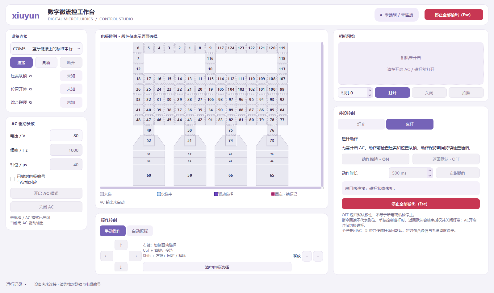

# Microfluidic Device · xiuyun

数字微流控设备的四块板硬件设计、STM32 主控固件与 Windows / PyQt5 上位机。

当前使用范围内的电极驱动、液滴移动、灯带、磁杆及上位机功能已由设备所有者完成联调。**荧光与加热暂未启用，不属于本次完成验证的功能。**



## 内容

| 目录 | 内容 |
|---|---|
| `hardware/Drop_Board/` | 1–4号板的Altium原理图、PCB、元件库、PDF及现有制造资料 |
| `firmware/DRIVE/` | STM32F407 主控源码、CubeMX配置、Keil工程及驱动依赖 |
| `firmware/prebuilt/Drop_Drive.hex` | 从当前使用工程保存的烧录文件 |
| `host/` | 上位机源码、测试、依赖及打包配置 |
| `host/assets/startup/xiuyun.mp4` | 2秒、1080p、60fps紫色渐变启动动画素材 |
| `docs/` | 界面预览与文件校验信息 |

本仓库保存当前主控工程，不包含其他板卡的历史实验固件。历史维护工具在 `firmware/DRIVE/tools/`，其README注明了与最终固件不兼容的旧调试命令。

## 硬件设计

使用 Altium Designer 打开各板目录中的 `Main_board1.PrjPcb` 至 `Main_board4.PrjPcb`。无需安装Altium也可查看同目录的PDF原理图。详见 [硬件文件说明](hardware/README.md)。

## 上位机运行

在 Windows 上安装 Python 3.12，然后在 `host` 目录运行：

```powershell
py -3.12 -m venv .venv
.venv/Scripts/python.exe -m pip install -r requirements.txt
.venv/Scripts/python.exe adapted_main.py
```

支持串口连接、AC开关、电极手动/自动流程、相机预览、灯光和磁杆控制。电极颜色表示界面/指令状态，不等于实测电压或液滴位置。详细操作见 [上位机使用说明](host/使用说明.md)。

### 打包 Windows 程序

```powershell
.venv/Scripts/python.exe -m pip install pyinstaller==6.22.3
.venv/Scripts/python.exe -m PyInstaller --noconfirm build_adapted.spec
```

产物为 `host/dist/DMF_Host_Adapted/`。复制到其他电脑时保留完整目录，不能只复制EXE。仓库不提交虚拟环境和约268MB的打包依赖目录；源码包含重建所需的界面、图标、动画和配置。

### 离线测试

在 `host` 目录执行：

```powershell
.venv/Scripts/python.exe -m unittest discover -s tests -v
```

测试使用离线模拟与Qt界面，不连接实际板卡。当前版本含73项测试。

## 固件工程

使用 Keil µVision 打开 `firmware/DRIVE/MDK-ARM/Drop_Drive.uvprojx`。工程配置为 STM32F407VETx、Arm Compiler 6，引用 `Keil.STM32F4xx_DFP 3.1.1` 和 `ARM.CMSIS 6.1.0`；需在本机安装匹配的芯片支持包和编译器。

AC/POL默认相位延时为40μs；压实与位置联锁已恢复。保留正式控制接口、通信超时与停止处理。预编译HEX来自最终使用工程，本次上传不重新烧录设备。

控制接口必须与实际板卡版本、接线及供电匹配。停止指令和界面提示不代表高压已经放电完成。

## 版本说明与授权

这是本设备当前调通版本的源码快照。荧光、温控、自动视觉反馈等扩展功能尚未在本版本启用或完成验证。

第三方驱动、库及原工程文件保留其原有版权和许可证声明。本仓库暂未为自有代码新增开源许可证；仓库公开不等于授予所有用途的授权。
